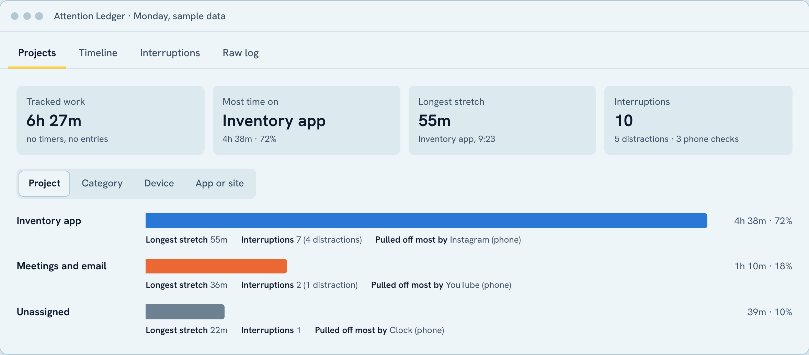
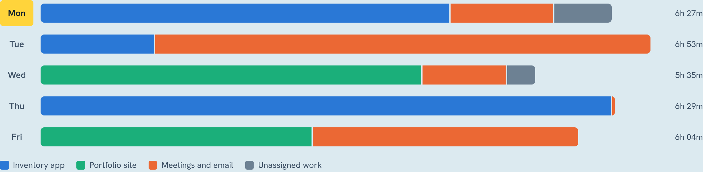
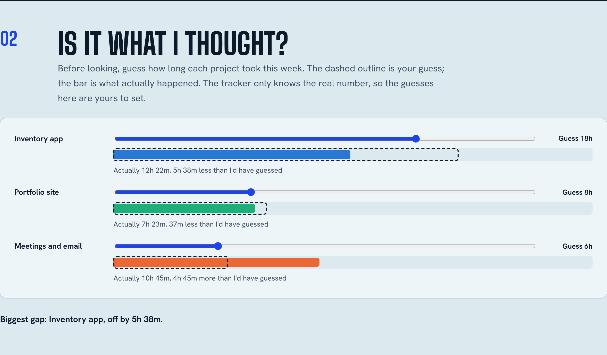
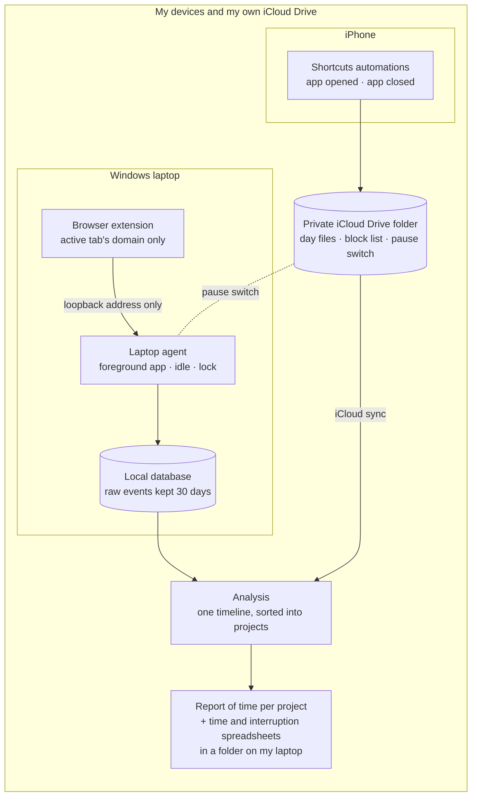
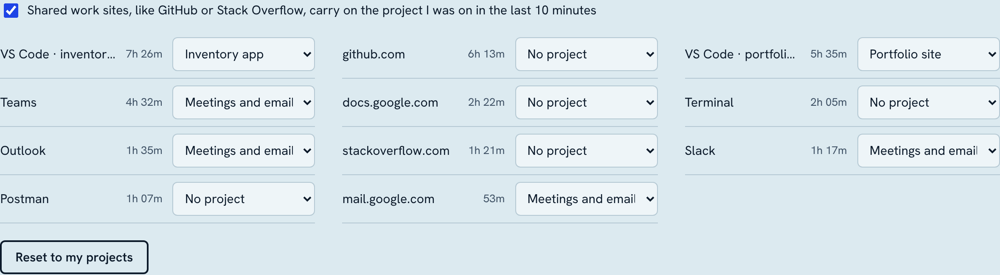
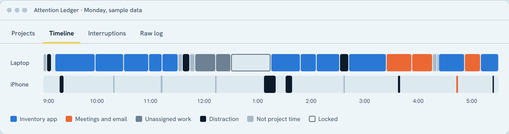
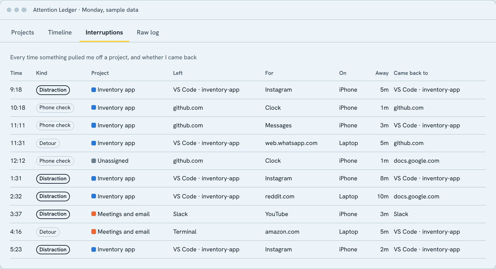
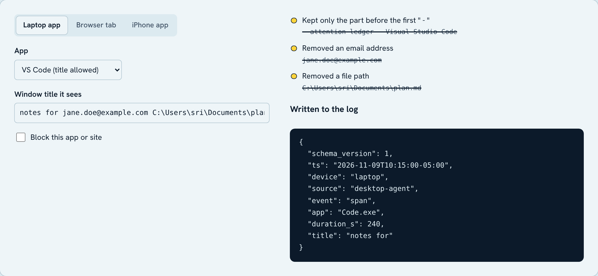
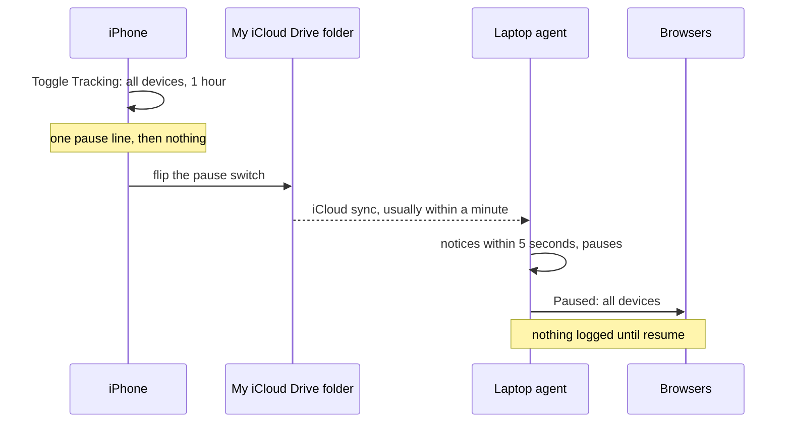
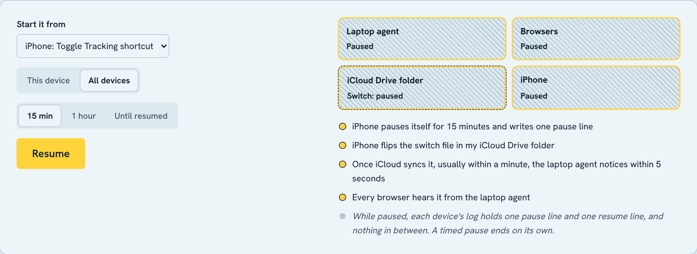

# Attention Ledger

Automatic time tracking across my Windows laptop and iPhone. It shows where my time actually went, project by project, without a timer or a timesheet, and what kept breaking up the long work.

Small collectors on each device write only to storage I own: a database on my laptop and a folder in my own iCloud Drive. The reports are exported to my laptop for me alone. Nothing is sent to a server, an account or any third party.

**This repository is the public design.** It explains how the system works and how it keeps the data private. The source code, and every minute it has recorded, stay private.

**[Read the full write-up, with interactive examples →](https://sriharish252.github.io/attention-ledger/)**



<sub>All screenshots use invented sample data.</sub>

## What it answers

I never really knew where my week went. Timers and timesheets only work if you remember them, and my sense of which project took the most time was often off. Attention Ledger answers three questions on its own:

1. **Where did the time go?** Time on each project across both screens, sorted automatically by VS Code workspace, site or app. Nothing to start, stop or fill in.
2. **Is it what I thought?** Next to my own guess, the real number shows where my sense of the week is off, and which projects quietly take more or less than I'd say.
3. **What keeps breaking it up?** Each project's longest unbroken stretch, how often it was interrupted and by what, phone included. It shows which work never gets a clean block of time.





## Principles

- **Private by design.** No keystrokes, screenshots, audio, message content, full web addresses or raw window titles are ever recorded. Only app names, website domains, and cleaned titles for apps I explicitly allow.
- **Only storage I own.** Data stays on my own devices and in my own iCloud Drive folder. No telemetry, no accounts, no servers, no third-party analytics.
- **I stay in control.** Any device can pause itself or every device. Any app or site can be blocked, and is then logged only as `Private` so the day's total still adds up.
- **Independent parts.** Each collector was built, tested and used on its own device for at least a day before any data was combined.

## How it works




The only network hop is iCloud syncing my own folder between my own phone and laptop. The browser extension talks to the laptop agent over the laptop's loopback address, which never leaves the machine.

### The parts

| Part | Reads | Never reads | Writes to |
|---|---|---|---|
| **Laptop agent** (Windows tray app) | The foreground window's app, time since the last input (not the input), screen lock, whether music is playing | Keys, clicks, screen contents; window titles unless the app is on an allowlist, and then only a cleaned piece | A database in my Windows profile, exported as one file per day |
| **Browser extension** (Chrome, Edge and other Chromium browsers) | The active tab's address, reduced to its domain the moment it is seen; which tabs are playing sound | Page contents, paths, search terms; browser pages, local files and local addresses are skipped | The browser's local storage, then the laptop agent. Browser sync is never used |
| **iPhone automations** (Shortcuts, with two small Scriptable scripts) | That an app opened or closed; Focus mode, charger and step-count signals | Anything inside an app | One file per day in my iCloud Drive, with a local fallback on the phone |
| **Analysis** (Python, nothing to install) | The day files from both devices, plus my project and category settings | Nothing else, and it makes no network calls | A report and two spreadsheets on my laptop |

## Projects

Projects live in a short settings file kept with my logs, never committed anywhere. Each project lists what belongs to it, and each piece of the timeline goes to the first project with a matching rule:

```toml
carry_minutes = 10

[[project]]
name = "Inventory app"
vscode = ["inventory-app"]          # VS Code workspace names
sites = ["inventory.example.com"]   # site domains, subdomains included

[[project]]
name = "Meetings and email"
apps = ["Outlook", "Teams"]         # laptop apps
sites = ["mail.google.com"]
phone_apps = ["Outlook", "Teams"]   # phone apps
```



- **VS Code.** Its window title normally starts with the file name. One VS Code setting, `"window.title": "${rootName}${separator}${activeEditorShort}"`, puts the workspace name first, so the cleaned title is enough to tell projects apart. Nothing more is recorded.
- **Shared work sites.** The browser only ever sees a domain, so `github.com` can't say which repo. Shared work sites like GitHub, Stack Overflow or an AI chat carry on the project I was on in the last 10 minutes. Otherwise they count as **unassigned** work rather than a guess.
- **What isn't project time.** Anything outside my focus categories (work and career by default), such as messages, shopping or a distraction, never counts toward a project.

Changing a rule regroups every past day the next time the report runs. Projects use only what the collectors already record, so they need no new data.

## What the report shows

1. **Where the time went:** time and share for each project, the longest unbroken stretch on it, how many times it was interrupted (and how many of those were distractions), interruptions per hour, and what pulled me off it most. Over several days, time per project per day too.
2. **Day by day:** time on screens, time on a task, switches per hour, the longest focus stretch, distractions and phone checks.
3. **What pulled me away**, and when those moments cluster.
4. **Every distraction**, with the task it pulled me off and whether I came back.

Two spreadsheets come with it: **`time.csv`**, every piece of the timeline with its category and project, for pivot tables of my own; and **`distractions.csv`**, every distraction, phone check and detour, with the project I left.



### What counts as an interruption



- **On a task:** the app or site in front is focus work (work and career by default), or was less than 2 minutes ago. Each interruption counts against the project of the task it pulled me off.
- **Distraction:** leaving project work for something in the distraction category, on either device, for 10 seconds or more.
- **Phone check:** picking up the phone during project work for anything else, like a message or the clock.
- **Detour:** a minute or more on something else on the laptop. Shorter detours, like a quick search, aren't counted.
- **Longest stretch:** the phone, another project, anything else for over 30 seconds, a pause or a gap ends it.
- **Passing through:** anything in front for under 3 seconds is folded into what came before, so switching past windows isn't counted as switching.
- **Phone sessions:** iOS has no "phone locked" signal, so an app with no close event ends at the first of: the next app, activity on the laptop, a Sleep Focus or charger change, or a cap (45 minutes for video, calls and maps; 20 for everything else).

## Where the data lives

| Where | What | Kept | Who can see it |
|---|---|---|---|
| Database on my laptop | Laptop and browser events | 30 days | Me, on my Windows account |
| The browser's own storage | A queue for the agent, and its own copy | 7 days | Me, in that browser profile |
| My iCloud Drive folder | The phone's day files, the block list, the pause switch | Until I delete them | Me, on my Apple account |
| A logs folder on my laptop | Day files, reports, the time and interruption spreadsheets, my projects and categories | Until I delete them | Me. Ignored by git, so never committed |

### What gets stored, and what doesn't

Window titles and web addresses are reduced before anything is written. A browser tab keeps only its registrable domain. A window title is kept only for apps on an allowlist, and then only the part before the first ` - `, with emails, web addresses, file paths, phone numbers and long runs of digits removed.



Never recorded:

- Keystrokes or mouse input
- Screenshots or screen contents
- Audio, messages, or what was playing
- Full web addresses, paths or search terms
- Raw window titles
- Names of blocked apps and sites: they appear as `Private`, with no title or domain

## The event format

Every collector writes the same format: [JSON Lines](https://jsonlines.org/), one event per line, one file per device per day. The format allows a fixed set of fields and **nothing else**, so a collector can't start recording something new, like a full address, without the format, its validator and its examples changing together.

```json
{"schema_version":1,"ts":"2026-11-09T09:25:30-05:00","device":"laptop","source":"browser-extension","event":"span","app":"msedge.exe","domain":"github.com","duration_s":240}
{"schema_version":1,"ts":"2026-11-09T09:30:00-05:00","device":"laptop","source":"desktop-agent","event":"span","app":"Code.exe","title":"inventory-app","duration_s":1500}
{"schema_version":1,"ts":"2026-11-09T09:31:12-05:00","device":"phone","source":"ios-shortcuts","event":"open","app":"Instagram"}
{"schema_version":1,"ts":"2026-11-09T09:41:00-05:00","device":"laptop","source":"desktop-agent","event":"span","app":"Private","private":true,"duration_s":95}
```

| Field | Meaning |
|---|---|
| `schema_version` | Always `1` for now |
| `ts` | ISO-8601 time **with** its UTC offset, so laptop and phone logs line up |
| `device` | `laptop` or `phone` |
| `source` | `desktop-agent`, `browser-extension`, `ios-shortcuts` or `ios-app` |
| `event` | `span`, `media`, `open`, `close`, `lock`, `unlock`, `idle_start`, `idle_end`, `pause`, `resume`, `label` or `context` |
| `app` | App or process name; `Private` for blocked apps |
| `domain` | Registrable domain only, lowercase. Never a path, query or full address |
| `title` | A cleaned window title, at most 200 characters, only for allowlisted apps |
| `duration_s` | Length of a span, 0 to 86,400 seconds |
| `private` | `true` when the app or site was blocked; then `app` must be `Private` with no `title` or `domain` |
| `paused`, `until`, `scope` | Tracking state, when a pause ends, and whether it covered one device or all |
| `label`, `value` | A short label or background signal, like `focus:work` or a step count |

## Pausing and blocking

Any device can pause itself, or every device, for 15 minutes, an hour or until resumed. While paused, each device writes exactly one `pause` line and one `resume` line, and nothing in between. A pause for all devices travels through a small switch file in the shared iCloud folder, so no server is involved:



A pause started on the laptop or in a browser reaches the phone the same way: the next time an automation runs, it sees the switch and logs nothing.



Blocking works from either side. Blocked apps and sites are logged as `Private`, so total time still adds up without the name ever being written.

## Hard parts

- **Telling projects apart from a domain and a title.** The browser sees only a domain, so shared work sites carry on the project I was just on, or count as unassigned. One VS Code setting makes the cleaned title name the workspace.
- **iOS won't share app usage.** Screen Time data can only be shown inside Apple's sandboxed view and can't be exported. Personal Shortcuts automations ("when Instagram opens, run this") are the one route into a file I own.
- **There is no "phone locked" signal.** Phone sessions are ended by the rules above instead.
- **Two collectors see the same screen.** The agent sees that a browser is in front; the extension knows which site. The timeline takes the site from the extension.
- **A pause has to reach every device without a server.** The shared iCloud folder doubles as the switch.
- **Making a leak impossible, not just unlikely.** The strict format means a new kind of data needs a deliberate format change.

## Testing

Each part has its own automated tests, about 250 in all, run on every change on Windows and Ubuntu, plus a manual checklist on the real device. A part counted as done only once its tests passed and it had run on the real device for at least a day.

## Status

In daily use on my laptop, browsers and iPhone since November 2026, with time per project added in late November. An optional iPhone companion app for motion data and quick labels may come later.

---

Built by [Sri Harish Jayaram](https://sriharish252.github.io/). Reach me on [LinkedIn](https://www.linkedin.com/in/sri-harish).

© 2026 Sri Harish Jayaram. All rights reserved. This repository describes a design; it contains no source code.
